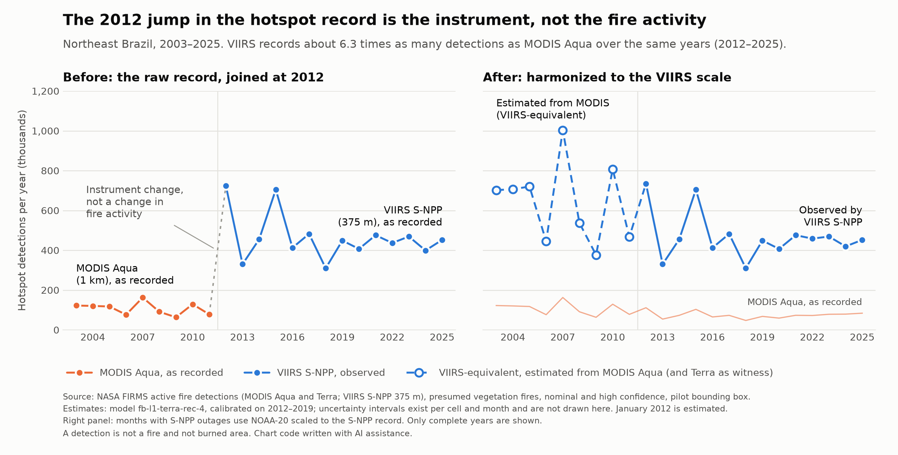

# Methodology

Living document, owned by Team Harmonization. It feeds the project page's detailed description.

- **Planned method:** [spec/harmonization.md](spec/harmonization.md). This file records what was actually done
  and what came out, with links to the diary entries and to `artifacts/`.

## Study area and period

- Extent processed: _TBD_ (default Brazil) · Demo region: _TBD_
- Period: _TBD_ · Grid: L2 = 0.25° · Time unit: local solar month

## Data used

| Sensor / satellite | `version` values found | Period used | Rows in | Rows after the main filter |
|--------------------|------------------------|-------------|---------|----------------------------|
| MODIS Aqua | | | | |
| MODIS Terra | | | | |
| VIIRS S-NPP | | | | |
| VIIRS NOAA-20 | | | | |

## Results: transfer function Aqua → VIIRS-equivalent (Northeast Brazil)

Source: NASA FIRMS archive detections, MODIS Aqua and Terra, VIIRS S-NPP and NOAA-20 375 m, clipped to the pilot
bounding box, `type = 0` (presumed vegetation fire), nominal and high confidence, gridded at 0.25° by local
solar month. Runs: ingest `20261114T235633Z_ingest_d60f88`, aggregate `20261115T001222Z_aggregate_aebb70`,
coverage `20261115T010717Z_coverage_fa7b98`, calibrate `20261115T013659Z_calibrate_2a1585`, validate `20261115T013707Z_validate_b9a70c`. Reproduce with `uv run astro-fire coverage`,
`calibrate` and `validate`. Full tables: [artifacts/metrics/](../artifacts/metrics/).

### Validation protocol

| Years | Role | Status |
|-------|------|--------|
| 2012–2019 | Calibration: factors, pooling level, weights, background type | Used |
| 2020–2021 | Development set: scored four times while the method was built | Used; **not a blind test** |
| 2022–2023 | **Final test**: scored once with `validate --final`, after the method is frozen | **Opened once**, Sun Nov 15, 01:40 UTC |
| 2024–2025 | Reported with the final test, separately (MODIS orbits drift in these years) | Opened in the same run |

The code refuses to calibrate on any held-out year and refuses to score 2022–2025 without `--final`.
Yearly raw totals per satellite for 2003–2025 and daily region-wide counts were seen during data checks;
no prediction was compared with 2022–2025 before the final run. The freeze (commit, settings, pass rule) was
pushed to GitHub as commit `9a66a68` one minute before that run.

**Pass rule, fixed before the final test is opened** (`validation.RULE`): the final method passes when
(1) it has a lower MAE and a lower RMSE than every baseline at cell-month level, and (2) on regional monthly
totals it is not distinguishably worse than the best baseline, meaning the 90% paired bootstrap interval of the
difference in absolute error is not entirely above zero. Scored on coverage-adequate months. If it fails, the
best baseline ships and the result is stated. This rule replaced a stricter one ("lower MAE at both levels")
after the development set showed that 24 monthly totals cannot resolve a 3% difference; because it was
written after seeing 2020–2021, passing it there is not evidence. The strict comparison is still reported.

### Observation gaps

FIRMS files list detections only, so an outage looks like a quiet period. A day counts as missing for a
satellite when it recorded at most 10% of the detections the other satellites imply, at least 30 were
expected, and this lasted three or more days in a row. A month is complete with at least 90% of its days
observed. A satellite flying alone (Terra before July 2002) is compared with its own usual day for
that month. Found in 2000–2026 (expected = detections implied by the other satellites, or by its own usual day):

| Satellite | First day | Last day | Days | Detections | Expected |
|---|---|---|---:|---:|---:|
| Terra | 2000-12-14 | 2000-12-18 | 5 | 0 | 497 |
| Terra | 2001-06-15 | 2001-07-03 | 19 | 9 | 1,527 |
| Terra | 2002-01-06 | 2002-01-11 | 6 | 4 | 190 |
| Terra | 2002-01-21 | 2002-01-23 | 3 | 6 | 95 |
| Terra | 2002-03-20 | 2002-03-28 | 9 | 0 | 151 |
| Aqua | 2002-07-30 | 2002-08-07 | 9 | 0 | 2,241 |
| Terra | 2003-12-17 | 2003-12-23 | 7 | 0 | 959 |
| SNPP | 2012-03-24 | 2012-03-26 | 3 | 16 | 1,432 |
| Terra | 2016-02-22 | 2016-02-25 | 4 | 0 | 208 |
| Aqua | 2020-08-16 | 2020-08-18 | 3 | 21 | 1,074 |
| Aqua | 2020-08-20 | 2020-08-23 | 4 | 21 | 1,015 |
| Aqua | 2020-08-27 | 2020-08-30 | 4 | 19 | 1,884 |
| Aqua | 2022-03-31 | 2022-04-02 | 3 | 5 | 190 |
| Aqua | 2022-04-04 | 2022-04-11 | 8 | 0 | 557 |
| SNPP | 2022-07-27 | 2022-08-10 | 15 | 0 | 40,063 |
| Terra | 2022-10-10 | 2022-10-22 | 13 | 33 | 9,140 |
| N20 | 2023-07-19 | 2023-07-22 | 4 | 0 | 9,447 |
| SNPP | 2024-05-30 | 2024-06-03 | 5 | 0 | 3,688 |
| SNPP | 2024-07-10 | 2024-07-16 | 7 | 0 | 10,162 |
| SNPP | 2024-07-25 | 2024-07-28 | 4 | 0 | 5,570 |
| SNPP | 2024-11-03 | 2024-11-06 | 4 | 0 | 13,717 |
| SNPP | 2026-03-10 | 2026-03-12 | 3 | 0 | 430 |
| SNPP | 2026-04-28 | 2026-04-30 | 3 | 0 | 580 |
| SNPP | 2026-07-11 | 2026-07-16 | 6 | 0 | 1,813 |

Incomplete months: Terra 2000-10, Terra 2000-12, Terra 2001-06, Terra 2002-01, Terra 2002-03, Aqua 2002-07, Aqua 2002-08, Terra 2003-12, SNPP 2012-01, Terra 2016-02, Aqua 2020-08, Aqua 2022-04, SNPP 2022-07, SNPP 2022-08, Terra 2022-10, N20 2023-07, SNPP 2024-07, SNPP 2024-11, SNPP 2026-07, N20 2026-11, SNPP 2026-11. Months in which Aqua or S-NPP is incomplete are left out of calibration and out
of the main validation scores (scores on all months are kept in the JSON). Single low days are not gaps:
MODIS swaths leave uncovered strips at low latitudes on some days and VIIRS does not. The gaps of 2003–2026
were checked against NASA and NOAA notices: of 17 gap events, 16 match a published event (one from a
secondary source only, one only likely) and the NOAA-20 gap of July 2023 has no notice ([resources.md](resources.md#official-notices-satellite-gaps-and-orbit-changes)). The gaps of
2000–2002 have not been checked.

### Calibration (2012–2019, January 2012 left out)

- 3,108 cells, 590,520 cell × month × day/night rows. S-NPP recorded 6.5 times as many detections as Aqua
  overall. The ratio is not one number: by day it runs from 2.5 (April) to 5.2 (October), by night from
  5.9 to 15.6, in months where Aqua detected something.
- Aqua recorded nothing in 83% of the rows; in 23% of all rows S-NPP saw detections that Aqua did not.
- **Terra as a witness.** In months where Aqua recorded nothing in a cell, S-NPP averaged 7.2 detections
  when Terra recorded something there and 0.8 when it did not (by night: 10.3 against 0.6). Terra is never
  added to Aqua; it only selects which of two backgrounds applies.
- Chosen by leave-one-year-out Poisson deviance, calibration years only: pooling to the 1° parent cell,
  `K = 50`, `M = 5`, Terra-aware background (`M = 5`). On zero-Aqua months the out-of-year deviance is 2.74
  with whole-extent pooling, 2.56 with parent pooling and 2.19 with the Terra-aware background.
- **Reconciliation with the regional ratio.** Each month's cell estimates are scaled so that their sum
  moves a fraction λ of the way toward `regional Aqua × ratio for that month and day/night`. The cells keep
  their spatial pattern; the regional total borrows the stability of the simple ratio. Not applied when the
  region has fewer than 30 Aqua detections in that month and period. Out-of-year scores on 2012–2019
  (rule set before running: lowest cell-month deviance, and no reconciliation unless it gains 0.5%):

  | λ | Cell-month deviance | Cell-month MAE | Regional monthly MAE |
  |---:|---:|---:|---:|
  | 0 | 3.616 | 3.273 | 2,963 |
  | 0.25 | 3.589 | 3.255 | 2,449 |
  | 0.5 | 3.573 | 3.242 | 2,046 |
  | **0.75** | **3.566** | 3.234 | **1,853** |
  | 1 | 3.570 | 3.232 | 1,872 |

  λ = 0.75 is chosen (deviance 1.4% lower than without). The ratio alone scores 1,872 on regional totals in
  the same folds.

Ratio of S-NPP to Aqua filtered detections by year, complete months only (stability check for the
assumption that the sensor relation holds over time):

| Year | 2012 | 2013 | 2014 | 2015 | 2016 | 2017 | 2018 | 2019 | 2020 | 2021 |
|---|---:|---:|---:|---:|---:|---:|---:|---:|---:|---:|
| Day | 5.08 | 5.13 | 5.02 | 5.12 | 5.10 | 5.06 | 5.41 | 5.33 | 5.22 | 5.13 |
| Night | 20.50 | 19.00 | 20.07 | 18.39 | 20.42 | 19.63 | 20.30 | 19.62 | 19.91 | 19.64 |
| All | 6.60 | 6.10 | 6.23 | 6.84 | 6.36 | 6.61 | 6.54 | 6.62 | 6.51 | 6.49 |

### Development-set result (2020–2021, August 2020 left out as an Aqua gap)

Each method predicts the S-NPP monthly count from Aqua alone (and Terra as witness for the final method).
Unit: detections per cell and month (143,152 rows, 3,112 cells); regional columns sum all cells, day + night,
per month (23 months).

| Method | Role | MAE, cell-month | RMSE, cell-month | Bias | Correlation | MAE, regional month | Bias, regional |
|---|---|---:|---:|---:|---:|---:|---:|
| Raw Aqua counts (no harmonization) | reference | 5.01 | 21.42 | -84.6% | 0.847 | 30942.0 | -84.6% |
| One global ratio | baseline | 4.04 | 14.83 | +0.3% | 0.847 | 2953.4 | +0.3% |
| OLS line V = a·A + b, global | baseline | 4.26 | 12.92 | +3.3% | 0.847 | 11327.6 | +3.3% |
| Ratio by month × day/night, no cell term | baseline | 3.66 | 12.85 | +0.3% | 0.884 | 2370.8 | +0.3% |
| F with pooling, no background | ablation | 3.10 | 10.51 | -15.1% | 0.909 | 5513.0 | -15.1% |
| F + static background B | ablation | 3.19 | 10.33 | +1.6% | 0.911 | 2846.0 | +1.6% |
| F + Terra-aware background B, not reconciled | ablation | 3.11 | 10.27 | +2.0% | 0.912 | 2612.2 | +2.0% |
| Final: F + background B, as fitted (Terra-aware, reconciled) | candidate | 3.07 | 10.15 | +0.8% | 0.914 | 2283.4 | +0.8% |

What this shows, and what it does not:

- **Per cell the final method is better than every baseline:** MAE 16% lower and RMSE 21% lower than the
  best baseline (ratio by month × day/night).
- **On region-wide monthly totals it is now level with the best baseline, slightly ahead:** MAE 2,283
  against 2,371. The paired difference averages −87 detections per month with a 90% interval of −254 to +68,
  so on 23 months the two are not distinguishable; the final method is closer in 11 of them.
- Each step moved the regional error: static background 2,846, Terra-aware 2,612, reconciled 2,283.
- Remaining weaknesses: night totals are 4.0% high (8.7% before reconciliation), and in low-season months
  the baseline is still slightly closer (MAE 917 against 975).
- Without any background the series is 15% low: it leaves out every month in which Aqua saw nothing.
- Removing the instrument effect is the large gain for every method: raw Aqua is 85% below S-NPP.
- This is the development set. It has been scored four times and every step was prompted by it, so these
  numbers are optimistic by construction. The claim rests on 2022–2023.

### How these numbers were reached (four looks at 2020–2021)

1. Weights by leave-one-year-out absolute error, pooling to the whole extent (`K = 50`, `M = 0`), all 24
   months: cell MAE 3.34, regional MAE 3,264, bias +1.0%.
2. Weights by Poisson deviance, wider grid, pooling to the 1° parent, all 24 months: cell MAE 3.27, regional
   MAE 3,252, bias +0.1%. Table: `artifacts/metrics/validation_dev_2020-2021_run2_static_background.md`.
   Absolute error had picked `M = 0` because for counts that are mostly zero it rewards predicting zero.
3. Gap mask and Terra-aware background: cell MAE 3.11, regional MAE 2,612, bias +2.0%
   (`validation_dev_2020-2021_run3_terra_background.md`). With August 2020 removed, the static background
   turned out further behind on regional totals than run 2 suggested: part of the earlier near-tie came from
   the background compensating for the Aqua outage.
4. Reconciliation with the regional ratio, λ = 0.75 (the table above).

Every change was chosen on 2012–2019 evidence, by a rule stated before the run, but each was prompted by
what 2020–2021 showed. That is why 2020–2021 is a development set and the claim rests on 2022–2023.

### Final test (2022–2023): the result the claim rests on

One run, `20261115T014038Z_validate-final_1f4753`, after the method was frozen at commit `e832477` (model `fb-l1-terra-rec-4`: pooling to the
1° parent, `K = 50`, `M = 5`, Terra-aware background, λ = 0.75). Left out as satellite gaps: 2022-04 (Aqua),
2022-07 and 2022-08 (S-NPP). 130,536 cell × month × day/night rows, 3,108 cells, 21 months. Tables:
`artifacts/metrics/validation_final_2022-2023.md` and `.json`.

| Method | Role | MAE, cell-month | RMSE, cell-month | Bias | Correlation | MAE, regional month | Bias, regional |
|---|---|---:|---:|---:|---:|---:|---:|
| Raw Aqua counts (no harmonization) | reference | 5.33 | 18.28 | -83.7% | 0.838 | 32873.1 | -83.7% |
| One global ratio | baseline | 4.60 | 14.71 | +6.2% | 0.838 | 3636.4 | +6.2% |
| OLS line V = a·A + b, global | baseline | 4.51 | 11.55 | +5.5% | 0.838 | 9912.8 | +5.5% |
| Ratio by month × day/night, no cell term | baseline | 4.22 | 13.92 | +6.3% | 0.854 | 2753.4 | +6.3% |
| F with pooling, no background | ablation | 3.52 | 10.83 | -10.4% | 0.888 | 4102.3 | -10.4% |
| F + static background B | ablation | 3.54 | 10.59 | +4.6% | 0.891 | 2836.2 | +4.6% |
| F + Terra-aware background B, not reconciled | ablation | 3.47 | 10.53 | +6.4% | 0.893 | 3072.6 | +6.4% |
| Final: F + background B, as fitted (Terra-aware, reconciled) | candidate | 3.46 | 10.43 | +6.3% | 0.896 | 2700.2 | +6.3% |

**The method passes the rule fixed in advance.**

- Per cell: MAE 18% lower than the best baseline on MAE (ratio by month × day/night, 4.22) and RMSE 10% lower
  than the best baseline on RMSE (OLS, 11.55).
- Regional monthly totals: MAE 2,700 against 2,753 for the best baseline. The paired difference averages −53
  detections per month, 90% interval −231 to +124: level with the baseline, not distinguishably better.
- With the three gap months included, the picture is the same (cell MAE 3.44 against 4.19).

**What the final test also shows, against us:**

- **Every method is about 6% too high in 2022–2023** (+4% in 2022, +8% in 2023). The relation between Aqua
  and S-NPP fitted on 2012–2019 no longer holds exactly: Aqua records relatively more than it did. The
  cell model does not correct this, and neither do the baselines.
- **In 2024–2025 the shift is large: every method is about 20% too high, 30% by day and unbiased by night.**
  The final method is still more accurate per cell than every baseline (MAE 3.88 against 4.61) and level on
  regional totals (7,040 against 6,924; interval of the difference −69 to +300), but a 20% bias means the
  2012–2019 factors should not be used to convert Aqua counts of those years. This is consistent with the
  drift of the MODIS orbits to later overpass times; it needs to be confirmed against the mission notices.
- Consequences for the product: (1) for 2012 onward the series uses observed VIIRS, so this bias does not
  enter it; (2) for 2003–2011 the factors are applied backward, where no test is possible. The ratio was
  stable from 2012 to 2021 (table above), which is the only evidence for the backward assumption, and the
  drift after 2021 shows the relation is not guaranteed to be stable.
- Each added step helped per cell, but on this test the static background has a smaller bias (+4.6%) than
  the final method (+6.3%), and the reconciliation is what brings the regional error back down (3,073 →
  2,700). Nothing was changed after seeing this.

**Why the bias appears after 2021: Aqua's overpass time drifted.** Median local solar time of the daytime
detections in the pilot extent, by year (`uv run python scripts/overpass_time.py`; full table in
`artifacts/metrics/overpass_time_by_year.json`):

| Satellite | 2003–2011 | 2012–2019 | 2020 | 2021 | 2022 | 2023 | 2024 | 2025 |
|---|---|---|---:|---:|---:|---:|---:|---:|
| Aqua, day | 13:35–13:40 | 13:37–13:39 | 13:38 | 13:38 | 13:43 | 13:56 | 14:19 | 14:56 |
| Terra, day | 10:26–10:30 | 10:27–10:29 | 10:28 | 10:25 | 10:15 | 10:01 | 09:42 | 09:13 |
| S-NPP, day | | 13:33–13:43 | 13:37 | 13:37 | 13:37 | 13:38 | 13:36 | 13:39 |
| NOAA-20, day | | 13:36 (2018–19) | 13:35 | 13:36 | 13:37 | 13:37 | 13:34 | 13:35 |

- Aqua crossed at the same local time, within five minutes, in every year from 2003 to 2021, and then moved
  later each year: 5 minutes in 2022, 18 in 2023, 41 in 2024, 78 in 2025. The VIIRS satellites did not move.
  A later afternoon overpass sees more of the daily fire cycle, so Aqua records more relative to VIIRS and
  factors fitted on 2012–2019 over-predict: by 4% in 2022, 8% in 2023 and about 20% in 2024–2025, by day only.
  The night bias is near zero, as expected if the cause is the afternoon fire cycle.
- **The years we reconstruct (2003–2011) have the same Aqua overpass time as the calibration years.** The one
  identified cause of the shift is absent there. This does not prove the relation was identical before 2012,
  but it removes the known reason for it to differ.
- The final test (2022–2023) was therefore run under conditions that had already started to drift, which is
  harder than the reconstruction task. We report its bias as measured.
- Terra, the witness, was stable until 2020 and drifted earlier from 2021; it is used as a witness only for
  2003–2011 in the product.
- This matches the mission record: Aqua's last inclination maneuver was on 2021-03-18 and its last drag
  make-up maneuver on 2021-12-01; Terra's last inclination maneuver was on 2020-02-27
  ([resources.md](resources.md#official-notices-satellite-gaps-and-orbit-changes)).

Late years, 2024–2025 (22 months; 2024-07 and 2024-11 left out as S-NPP gaps):

| Method | Role | MAE, cell-month | RMSE, cell-month | Bias | Correlation | MAE, regional month | Bias, regional |
|---|---|---:|---:|---:|---:|---:|---:|
| Raw Aqua counts (no harmonization) | reference | 4.77 | 18.26 | -81.5% | 0.760 | 28981.2 | -81.5% |
| One global ratio | baseline | 5.27 | 17.71 | +20.5% | 0.760 | 7499.0 | +20.5% |
| OLS line V = a·A + b, global | baseline | 5.06 | 14.09 | +18.9% | 0.760 | 11453.7 | +18.9% |
| Ratio by month × day/night, no cell term | baseline | 4.61 | 15.29 | +19.4% | 0.822 | 6923.7 | +19.4% |
| F with pooling, no background | ablation | 3.84 | 12.41 | +0.6% | 0.852 | 4859.5 | +0.6% |
| F + static background B | ablation | 3.89 | 12.22 | +16.7% | 0.856 | 6234.3 | +16.7% |
| F + Terra-aware background B, not reconciled | ablation | 3.85 | 12.16 | +20.1% | 0.858 | 7285.8 | +20.1% |
| Final: F + background B, as fitted (Terra-aware, reconciled) | candidate | 3.88 | 12.26 | +19.7% | 0.853 | 7039.9 | +19.7% |

(The near-zero bias of "F, no background" in these years is two errors cancelling: it leaves out the
zero-Aqua months, and the drift inflates the rest.)

### Before and after: the 2012 step

Yearly hotspot detections in the pilot extent, 2003–2025 (`uv run python scripts/figure_before_after.py`;
numbers in `artifacts/figures/before_after_2012.json`). Read as one record, the archive jumps from 78
thousand detections in 2011 (MODIS Aqua) to 724 thousand in 2012 (VIIRS S-NPP). In the harmonized record
the estimated years (2003–2011) range from 376 to 1,003 thousand and the observed years (2012–2025) from 310
to 735 thousand. The estimated years are higher on average; MODIS Aqua's own record shows the same decline
(107 thousand per year on average in 2003–2011, 73 thousand in 2012–2021), so that difference is in the
source data and not created by the conversion. The chart has no uncertainty band yet, and it shows annual
totals: 2022 and 2024 include months with S-NPP outages and are low for that reason.

### Uncertainty of the estimates

Intervals come from measured error, not from a model of it. For each calibration year the whole method is
refitted on the other seven years and applied to that year as in production; the estimates are compared
with what S-NPP observed. The errors are summarized by regime (Aqua > 0 or Aqua = 0), period (day, night,
both) and size of the estimate (bins of log2), giving for each group the 5th and 95th percentiles of
observed / estimated and the mean squared error per unit of estimate (`processed/uncertainty/v1`).

- This replaced the planned bootstrap over calibration years. The bootstrap only measures how uncertain the
  factors are; the scatter of the counts themselves is far larger (variance 3 to 50 times the estimate,
  where a Poisson count would have 1).
- **Check on years the intervals never saw:** on 2020–2021 the 90% interval contains the observed count in
  94.2% of 142,968 cell-months (91.7% where Aqua > 0, 94.7% where Aqua = 0). It is above 90% because counts
  cannot go below zero, so the lower bound is rarely exceeded. Not checked on 2022–2023, to keep that test
  to a single run; the 6% bias found there would lower the coverage.
- At cell level the intervals are wide: for an estimate of about 40 detections, 0.35 to 1.9 times the
  estimate by day. Sums over many cells are relatively much more precise.
- **Sums of cells:** errors of neighboring cells move together, so adding the variances understates the
  uncertainty of a sum: by a factor of 2.4 for a 1° cell (16 cells) and 13.7 for the whole extent (about
  3,100 cells), roughly `n_cells^0.32`. The app should widen summed intervals by that factor and say it is
  approximate.
- An estimate of exactly zero has no interval (none occurs in the current calendar).

### Anomalies

Per cell, month of year and period, over all fully observed years 2003–2025: historical median, absolute
and percent anomaly, and robust z-score `(count − median) / (1.4826 × MAD)`. A fully observed month with no
detection counts as zero in the history, although it has no row in the table. Partial months get no
anomaly. In sparse cells the MAD is small and z is extreme (19% of cell-months have |z| ≥ 2), so per-cell z
is a rough indicator; for an area, sum the cells first and compute the anomaly on the sum.

### Continuity after S-NPP, and the current year

S-NPP stopped observing on 2026-11-02; NOAA-20 carries the series on. Over the 88 months in which both were
fully observing (2018–2025), S-NPP recorded 1.041 times as many detections as NOAA-20 (1.052 by day, 1.015
by night; 0.97 to 1.08 by month and period; 1.03 to 1.06 by year), inside the 0.9–1.1 range set in the spec.
2026 is left out of the ratio because S-NPP was already failing.

How the observed series is assembled from February 2012:

- A month in which S-NPP was fully observing uses S-NPP as recorded (172 months).
- Otherwise it uses the VIIRS satellite with more days observed, which is NOAA-20, multiplied by the ratio
  for that month and period (`processed/continuity/v1`): the S-NPP outage months 2022-07, 2022-08, 2024-07,
  2024-11 and 2026-07, and 2026-11 onward. These are still labeled `VIIRS_OBSERVED`, with
  `source_satellite = N20`.

2026 comes from the FIRMS area API (`astro-fire ingest-api`): standard-processing files to July,
near-real-time files from August (`is_nrt`). **Near-real-time files have no `type` field, so every NRT
detection is treated as type 0**; in the standard files of January–July 2026, 1.4% to 4.5% of detections per
month had another type and were removed, so the NRT months are slightly high by that order.

**The current month.** The data ends on 2026-11-14. November 2026 is marked partial (14 of 30 days) and is
compared like for like: its history is the S-NPP detections on days 1–14 of November in each earlier year
in which S-NPP observed all 14 days (2012–2023 and 2025; 2024 had an outage on Nov 3–6), from
`processed/month_to_date/v1`. For the whole extent, Nov 1–14 2026 has 20,380 VIIRS-equivalent detections
against a median of 22,785 for the same days (range 12,602 to 47,748). Other partial months get no anomaly.

**To check:** August–October 2026 has 163 thousand S-NPP detections, the lowest fire season in the record
(previous minimum 203 thousand in 2018), and NOAA-20 agrees (159 thousand). Both satellites showing it makes
an instrument artifact unlikely, but the 2026 files come from the API and the earlier years from the archive,
and we have not compared the two sources on the same dates.

### Sensitivity to the confidence filter

Calibration and the development-year validation were rerun with three definitions of a counted detection
(all of type 0), with the method and its selection rules unchanged (`scripts/filter_sensitivity.py`;
`artifacts/metrics/filter_sensitivity.md`). The final test years were not used.

| Filter | VIIRS / Aqua | Model chosen | MAE cell-month (best baseline) | RMSE (best baseline) | Bias | MAE regional month (best baseline) | Passes the rule | Interval coverage |
|---|---:|---|---:|---:|---:|---:|---|---:|
| Nominal and high (main) | 6.52 | l1, K=50, M=5, Terra-aware, λ=0.75 | 3.07 (3.66) | 10.15 (12.85) | +0.8% | 2,283 (2,371) | yes | 94.2% |
| All confidence classes | 7.13 | l1, K=50, M=5, Terra-aware, λ=0.75 | 3.32 (4.00) | 10.86 (13.38) | +2.6% | 2,867 (2,880) | yes | 94.3% |
| High only | 1.43 | l1, K=100, M=20, Terra-aware, λ=1 | 0.370 (0.372) | 1.75 (1.89) | -4.4% | 362 (361) | yes, by a margin of 0.6% | 97.8% |

- Including low-confidence detections changes the sensor ratio (7.1 instead of 6.5) but not the conclusion:
  the same model is chosen and it beats the baselines by the same margin.
- With high confidence only, the advantage over the baselines almost disappears and the model leans fully on
  the regional ratio. High confidence is not the same thing on the two sensors (0–100 on MODIS, tied to
  detector saturation on VIIRS), so this filter compares unlike detections. It supports keeping the main
  filter and not treating confidence as equivalent across sensors.

### Extending the record before 2003

**Added: Aqua from its first months.** The calendar now starts in July 2002. September–December 2002 are
estimated with the frozen Aqua factors (same sensor, same overpass time, same assumption as 2003–2011);
July and August 2002 are marked partial (Aqua outage, July 30 to August 7).

**Not added: the Terra-only months (November 2000 to June 2002).** We fitted the frozen method with Terra as
the source (`scripts/terra_source_factors.py`). On the development years it passes the rule comfortably:
cell-month MAE 3.83 against 4.89 for the best baseline, regional MAE 3,695 against 4,044, bias +1.9%, 94.4%
interval coverage (`artifacts/metrics/validation_terra_source_dev_2020-2021.md`). **We still do not use it,
because the relation it relies on was different in the years it would be applied to:**

| Daytime Terra / Aqua detections | 2002–2006 | 2007–2011 | 2012–2021 |
|---|---:|---:|---:|
| Range of yearly values | 0.26–0.35 | 0.33–0.42 | 0.48–0.52 |

- Terra recorded about half as many daytime detections relative to Aqua in the early 2000s as in the
  calibration years. Terra factors fitted on 2012–2019 would therefore put the Terra-only months roughly 45%
  too low by day. Night is stable (2.2 to 2.7 throughout).
- It is not an instrument or processing artifact that we can find: MODIS product version is 6.2 for every
  year from 2000 to 2017; both overpass times are constant until 2021; and the strength of the detections
  did not change for either satellite (Aqua median FRP 28–33 MW, Terra 21–26 MW, in every year 2003–2021).
  The change is concentrated in the fire-season months. The reading that fits these facts is a change in
  what was burning at 10:30 relative to 13:30, which a three-hour difference in overpass makes visible.
- **What this means for the main series.** Aqua and S-NPP cross at the same local time, so the Aqua → VIIRS
  relation does not depend on the time of day of burning; that is why the pair was chosen. The two MODIS
  records do disagree on the long-term trend: Aqua's yearly detections fall by about a third from 2003–2011
  to 2012–2021, Terra's do not fall (49 thousand per year in both periods). The harmonized series follows
  Aqua, the afternoon view, which is the one VIIRS has. It should be read as activity at the early-afternoon
  overpass, not as all-day activity.
- Terra is used in the main method only as a witness for the background. In the reconstructed years it marks
  5.6% of the zero-Aqua cell-months as active, against 6.9% in the calibration years, and replacing the
  Terra-aware background with the static one changes the 2003–2011 total by 0.1%. The shift does not
  propagate into the series.
- The lesson for the method as a whole: passing a forward test does not prove a relation held in the past.
  For Aqua the support is physical (same overpass as VIIRS, constant orbit until 2021, unchanged detection
  strength), not statistical.

Possible later: convert Terra to Aqua-equivalent with the relation of the nearest years (2002–2004) and
then apply the Aqua factors. Not done: it stacks two estimates and assumes the early Terra–Aqua relation
held back to 2000.

### Still to fill in

| Item | Status |
|------|--------|
| Terra-only 2000-11 → 2002-06 | Fitted and checked, **not used** (relation not stable backward) |
| API files compared with archive files on the same dates (2026 looks unusually low) | Not done |
| Uncertainty band on the before/after chart (regional annual totals) | Not done |
| Gap dates of 2000–2002 checked against instrument notices | Not done (2003–2026 are checked) |

## Findings from the team's Belize 2020 audit (pilot, one country, one year)

MODIS (Terra + Aqua) 1,505 rows vs VIIRS NOAA-20 6,655 rows; overall ratio 4.42, 4.05 by day and 6.22 by night;
daily ratio interquartile range 2.50–6.75; April holds over half the detections. Median pixel footprint
1.43 km² (MODIS) vs 0.196 km² (VIIRS). 316 VIIRS rows at the I4 saturation limit (367 K). Within ±15 min and
5 km, every MODIS–VIIRS candidate pair involved Aqua, none Terra. These motivated: no fixed multiplier, separate
day/night, same-overpass pairs, per-sensor filters.

## Limitations

See [spec/harmonization.md](spec/harmonization.md#13-limitations-to-state-everywhere). Add what the results reveal.
